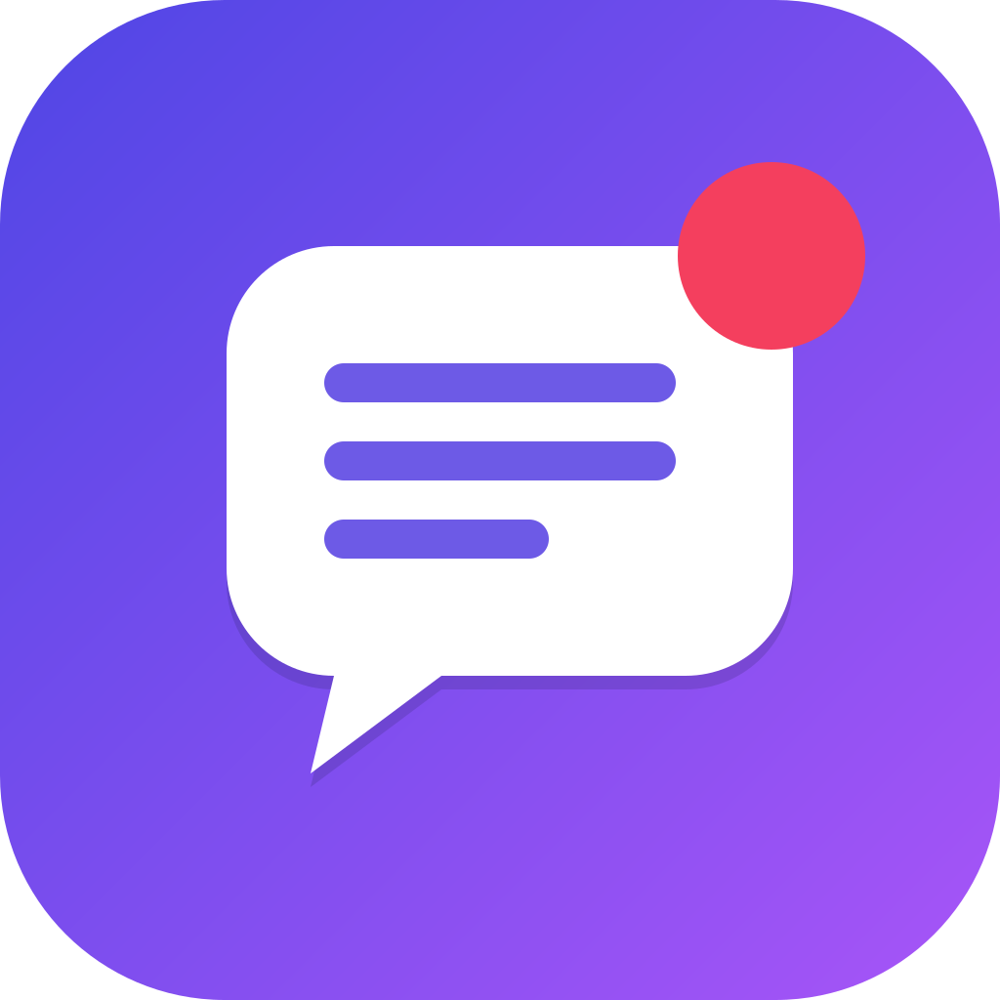
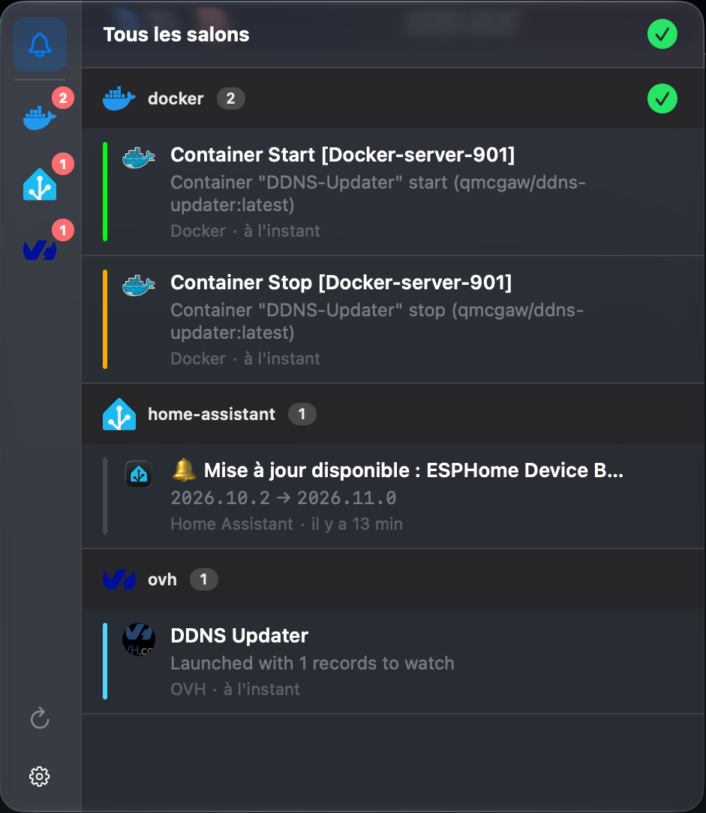

<p align="center">
  
</p>

<h1 align="center">HookBar</h1>

<p align="center">
  <a href="https://github.com/Aervorn/MacOS_HookBar/releases/latest"></a>
  
  
  <a href="LICENSE"></a>
</p>

<p align="center">
  <a href="README.md">🇬🇧 English</a> · 🇫🇷 Français
</p>

---

HookBar affiche les messages de tes salons Discord dans la **barre de menus de macOS**, pour ne plus avoir à ouvrir Discord pour les voir. Elle est faite pour tous ceux qui se servent de Discord comme centre de notifications : alertes d'un homelab (Uptime Kuma, Proxmox, Synology, Home Assistant, Watchtower, tes propres scripts…) postées sur ton propre serveur par des bots et des webhooks.

La barre de menus indique combien de messages attendent. Un clic ouvre une fenêtre inspirée de [Gitify](https://gitify.io) : à gauche les salons qui ont des messages non lus, à droite leurs messages. Un salon sans message non lu disparaît de la liste.

> [!IMPORTANT]
> **HookBar a besoin de ton propre bot Discord.** Ça prend cinq minutes et c'est expliqué pas à pas dans [Créer ton bot](#-créer-ton-bot). HookBar lit ton serveur avec ce bot : elle n'utilise pas ton compte personnel, ne lit pas tes messages privés et ne poste jamais rien.

> [!NOTE]
> **Réalisée avec l'aide de l'IA.** HookBar est un projet personnel que j'ai réalisé avec [Claude](https://claude.ai), l'assistant IA d'Anthropic : mes compétences seules n'auraient pas suffi à la coder entièrement moi-même. J'ai décidé de ce que l'app devait faire, fait les choix d'interface et testé chaque version sur mon propre homelab ; Claude a écrit une grande partie du code. Autant le dire clairement.

## 📸 Captures d'écran

<p align="center">
  
</p>

## ✨ Fonctionnalités

### 🔔 Barre de menus
- Une cloche avec le **nombre de messages non lus** ; une cloche barrée quand Discord est injoignable.
- Pas d'icône dans le Dock ni dans ⌘⇥ : HookBar vit uniquement dans la barre de menus.

### 🗂️ La fenêtre
- **Barre de gauche** : « Tous les salons », puis chaque salon qui a des messages non lus, avec l'icône de son application et une pastille. Actualiser et Réglages en bas.
- **À droite** : les messages non lus du salon choisi, ou de tous les salons regroupés par salon.
- **Embeds** comme dans Discord : barre de couleur, titre, description, champs côte à côte, image, pied, avatar de l'auteur.
- **Clic sur un message pour le déplier** en entier, avec ses liens, ses pièces jointes et un lien **Ouvrir dans Discord**.
- Les messages **restent jusqu'à ce que tu les marques comme lus**, même après un redémarrage.

### ✅ Marquer comme lu
- Une coche verte sur chaque message (au survol), sur chaque salon et en haut pour tout. Une coche n'apparaît que si elle fait quelque chose qu'aucune autre coche visible ne fait déjà : pas de coche de salon pour un seul message, pas de coche générale pour un seul salon.
- **Option** : cliquer sur un message le marque aussi comme lu. Il reste alors affiché, estompé, jusqu'à la fermeture de la fenêtre, et peut redevenir non lu.

### 🎨 Icônes des salons
- Chaque salon reçoit l'icône de son application, tirée du catalogue [selfh.st](https://selfh.st/icons) (environ 3 000 icônes d'auto-hébergement), trouvée **automatiquement d'après son nom** : `home-assistant`, `proxmox`, `synology`… Les fautes de frappe et variantes sont reconnues (`proxmmox`, `ad-guard`, `jdownloader2`), ainsi que quelques alias (`nut` → Network UPS Tools, `unifi` → UniFi).
- Les salons génériques reçoivent un symbole (`security` → bouclier, `alertes` → triangle d'alerte), sinon leur initiale.
- **Réglages** : clic sur une icône pour chercher dans le catalogue, choisir un symbole ou l'initiale.

### 📣 Bannières
- Bannière macOS facultative **par salon**, à chaque nouveau message.
- Après une longue coupure, une seule bannière récapitulative au lieu d'une avalanche.

### 🔄 Fiable
- Connexion en temps réel (Gateway de Discord), avec reconnexion automatique après une coupure réseau ou à la sortie de veille du Mac.
- **Rien n'est perdu** : à la reconnexion, HookBar récupère les messages postés pendant la coupure (jusqu'à 100 par salon).
- Les nouveaux salons de ton serveur sont suivis automatiquement (désactivable).

### ⚙️ Et aussi
- Interface en **français et en anglais** (langue du système, ou au choix dans les Réglages).
- Apparence **claire, sombre ou automatique**.
- Option **d'ouverture à la connexion**.
- Icône conçue pour macOS 26 : elle s'adapte aux styles d'icône clair, sombre, transparent et teinté.

## 🧩 Compatibilité

**macOS 26 (Tahoe) ou ultérieur**, sur Mac Apple Silicon et Intel.

Il te faut un serveur Discord où tu peux inviter un bot, ce qui demande la permission **Gérer le serveur**. HookBar affiche les **nouveaux messages** : Discord ne communique pas ton état lu/non lu personnel aux bots. Les messages postés avant la connexion de HookBar ne sont donc pas importés, et lire un message dans Discord ne le marque pas comme lu dans HookBar.

## 🤖 Créer ton bot

À faire une seule fois, sur le site de Discord.

1. Ouvre le [portail développeur Discord](https://discord.com/developers/applications) et clique sur **New Application**.

> [!TIP]
> Discord refuse les noms d'application qui contiennent « Discord ». Appelle-la comme tu veux, par exemple « Homelab Relay » : ce n'est que le nom du bot sur ton serveur.

2. Onglet **Bot** : clique sur **Reset Token** et copie le jeton.

> [!CAUTION]
> Le jeton est le mot de passe de ton bot. Colle-le uniquement dans HookBar, jamais dans une discussion, une issue ou une capture d'écran. S'il fuite, clique de nouveau sur **Reset Token** : l'ancien ne fonctionne plus.

3. Toujours dans **Bot**, sous **Privileged Gateway Intents**, active **Message Content Intent** et enregistre.

> [!WARNING]
> Sans **Message Content Intent**, Discord refuse la connexion et HookBar affiche une erreur. Un bot présent sur moins de 100 serveurs n'a pas besoin de l'accord de Discord pour l'activer.

4. Onglet **OAuth2 › URL Generator** : coche le scope `bot`, puis les permissions **View Channels** et **Read Message History**. Ouvre l'URL générée en bas de la page et invite le bot sur ton serveur.
5. **Salons privés** : donne au bot (ou à son rôle) l'accès à ceux que tu veux suivre.

## ⚙️ Mise en route

1. Clique sur la cloche dans la barre de menus, puis sur **Ouvrir les Réglages**.
2. Colle le jeton de ton bot et clique sur **Enregistrer et se connecter**. L'état indique **Connecté** avec le nom du bot.
3. Tes salons apparaissent dans les Réglages. À la première connexion, ils sont tous suivis : décoche ceux qui ne t'intéressent pas, active les bannières où tu en veux, change une icône si besoin.

Pour vérifier que tout marche, poste un message dans un salon suivi (ou envoie une notification de test depuis un de tes outils) : le compteur apparaît à côté de la cloche dans la seconde.

## 🔐 Autorisations demandées

| Autorisation | Pourquoi | Quand |
|---|---|---|
| **Trousseau** | Le jeton du bot y est rangé. | Au premier lancement ; après une mise à jour, macOS peut redemander : clique sur **Toujours autoriser**. |
| **Notifications** | Bannières des nouveaux messages (facultatif). | La première fois que tu actives la bannière d'un salon. |
| **Ouverture** | Ouvrir HookBar à la connexion (facultatif). | Quand tu actives l'option ; elle apparaît dans **Réglages système › Général › Ouverture**. |

## 🔒 Confidentialité

HookBar ne collecte rien et n'envoie rien sur toi : pas de compte, pas de statistiques, pas de pistage. Les messages non lus et les réglages restent sur ton Mac (`~/Library/Application Support/HookBar`), le jeton dans ton trousseau. Les seules requêtes réseau sont :

- Discord, avec le jeton de ton bot : connexion en temps réel et récupération des messages manqués ;
- les serveurs d'images de Discord : avatars des auteurs et images des embeds ;
- jsDelivr : le catalogue et les icônes selfh.st (gardés en cache sur ton Mac) ;
- les mises à jour (ce dépôt GitHub).

## 📥 Installation

1. Télécharge `HookBar-x.y.z.dmg` depuis la [dernière release](https://github.com/Aervorn/MacOS_HookBar/releases/latest).
2. Ouvre-le et glisse **HookBar** sur le dossier **Applications**.
3. Lance HookBar depuis ton dossier Applications : la cloche apparaît dans la barre de menus.

> [!WARNING]
> **HookBar n'est pas notariée par Apple.** Elle est signée avec le certificat de l'auteur, pas avec un compte Apple Developer payant : macOS la bloque à la première ouverture. C'est normal, il suffit de l'autoriser une fois :
>
> 1. Ouvre HookBar : macOS indique qu'il ne peut pas la vérifier. Clique sur **Terminé**.
> 2. Ouvre **Réglages système › Confidentialité et sécurité** et descends jusqu'à la section **Sécurité**.
> 3. À côté du message sur HookBar, clique sur **Ouvrir quand même**, puis confirme avec ton mot de passe.
>
> Si tu préfères le Terminal : `xattr -dr com.apple.quarantine /Applications/HookBar.app`
>
> Tu peux vérifier que le téléchargement est authentique en comparant son empreinte SHA-256 (`shasum -a 256 HookBar-x.y.z.dmg`) avec celle des notes de version.

## 🔄 Mises à jour

HookBar se met à jour toute seule : elle cherche une nouvelle version une fois par jour et propose de l'installer, avec ses notes de version (ou **⚙ › Rechercher les mises à jour…** dans la fenêtre). Les mises à jour sont signées, et HookBar refuse tout fichier qui n'a pas été signé par l'auteur. La recherche automatique se désactive dans **Réglages › Mises à jour**. Les messages non lus, les réglages et le jeton sont conservés.

## 📝 Historique des versions

### 0.1.0
- Première version publique : compteur dans la barre de menus, fenêtre façon Gitify, embeds Discord, marquer comme lu (coches ou clic), salons et bannières dans les Réglages, icônes selfh.st automatiques, rattrapage des messages manqués, français et anglais, mode clair et sombre, ouverture à la connexion, mises à jour Sparkle.

## 🛠️ Compilation depuis les sources

Prérequis : Xcode 26 ou ultérieur, macOS 26 ou ultérieur, et [XcodeGen](https://github.com/yonaskolb/XcodeGen) (le projet Xcode est généré à partir de `project.yml`).

```bash
brew install xcodegen
git clone https://github.com/Aervorn/MacOS_HookBar.git
cd MacOS_HookBar
./scripts/build.sh          # compile en Debug et lance l'app
./scripts/build.sh --test   # pareil, avec les tests
```

Ou `xcodegen generate`, puis ouvre `HookBar.xcodeproj`, choisis le schéma **HookBar** et **Mon Mac**, puis **Product › Run** (⌘R). Les tests se lancent avec **Product › Test** (⌘U). Le projet est en **Sign to Run Locally** : aucun compte développeur Apple n'est nécessaire. Après un `git pull` qui ajoute ou supprime des fichiers, relance `xcodegen generate`. Les mises à jour sont désactivées dans les versions Debug.

```
HookBar/
├── HookBarApp.swift        point d'entrée, barre de menus, fenêtres
├── Core/                   logique sans interface (testée) : modèles Discord, icônes, identifiants
├── Services/               Gateway et REST Discord, état central, icônes, notifications, trousseau, préférences, mises à jour
├── Views/                  interface SwiftUI (fenêtre, réglages, choix d'icône, À propos)
├── Localizable.xcstrings   textes en français et en anglais
└── AppIcon.icon            icône de l'app (Icon Composer)
HookBarTests/               tests (Swift Testing)
Design/                     calques de l'icône, fond du DMG et les scripts qui les génèrent
scripts/build.sh            compilation Debug et lancement
scripts/make-dmg.sh         fabrique le DMG d'une version et l'appcast Sparkle
```

Pour fabriquer un DMG comme ceux publiés, `scripts/make-dmg.sh` génère le projet, archive l'app, vérifie sa signature et crée l'image disque. Il faut [create-dmg](https://github.com/create-dmg/create-dmg) (`brew install create-dmg`) et un certificat de signature, dont le nom est indiqué en haut du script. Le script signe aussi le DMG pour Sparkle et réécrit `appcast.xml`, ce qui demande une clé EdDSA dans ton trousseau (`generate_keys`, fourni avec Sparkle) dont la partie publique est dans `project.yml`.

## 🤝 Contribuer et signaler un problème

Les signalements de bugs, les idées et les pull requests sont les bienvenus !

- **Un bug ?** [Ouvre une issue](https://github.com/Aervorn/MacOS_HookBar/issues/new) avec ta version de macOS, ce que tu as fait et ce qui s'est passé.
- **Un salon reçoit la mauvaise icône ?** Indique le nom du salon et l'icône attendue : la reconnaissance automatique peut apprendre de nouveaux alias.
- **Une pull request ?** Garde-la centrée sur un seul changement, et vérifie que les tests passent (⌘U). Les textes de l'interface sont en français et en anglais (`Localizable.xcstrings`).

> [!CAUTION]
> Ne colle jamais le jeton de ton bot dans une issue, un journal ou une capture d'écran.

## ⚠️ Avertissement

HookBar est fournie **« telle quelle », sans aucune garantie**. L'auteur ne peut être tenu responsable d'une notification manquée, d'une perte de données ou de tout autre dommage.

HookBar n'est ni affiliée à Discord, ni approuvée par Discord. Discord est une marque de Discord Inc., citée seulement pour décrire avec quoi l'app fonctionne. Les icônes d'applications viennent de [selfh.st/icons](https://selfh.st/icons) (CC BY 4.0) ; les logos appartiennent à leurs propriétaires.

## 📄 Licence

HookBar est distribuée sous [licence MIT](LICENSE).

Les mises à jour utilisent [Sparkle](https://sparkle-project.org), distribué sous licence MIT.
