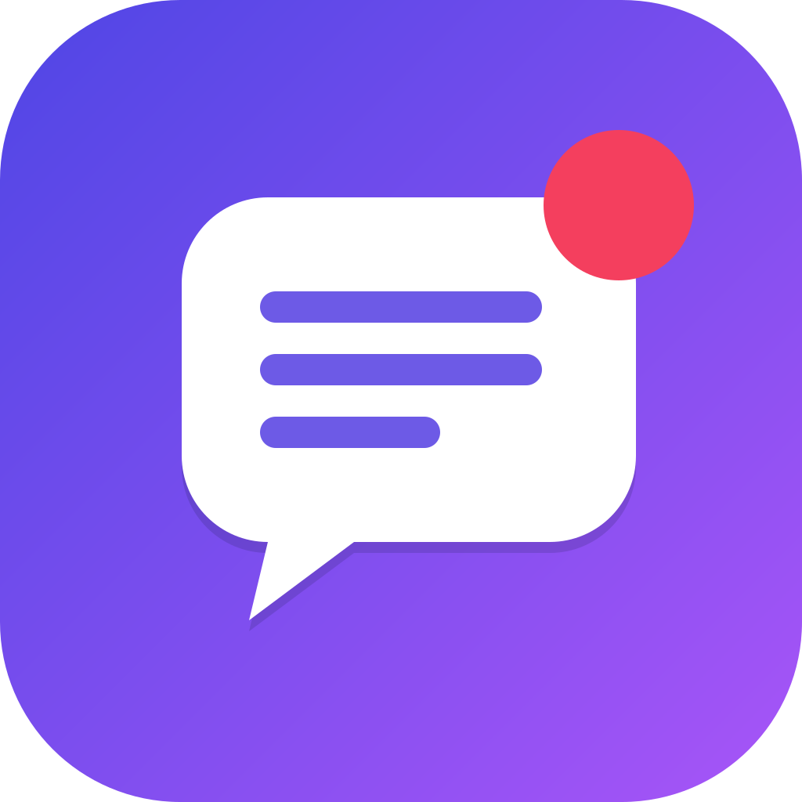
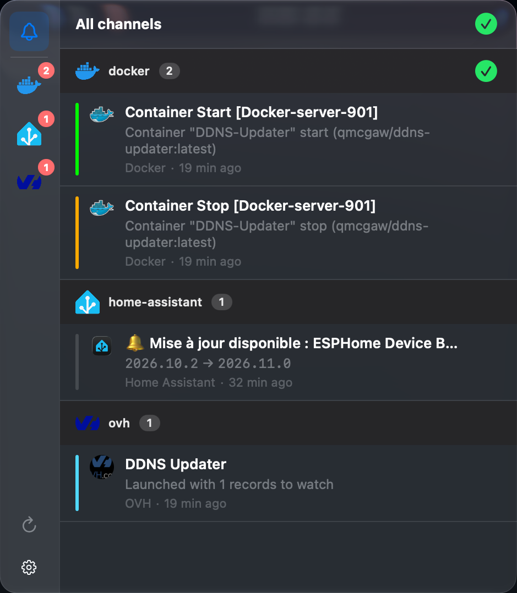

<p align="center">
  
</p>

<h1 align="center">HookBar</h1>

<p align="center">
  <a href="https://github.com/Aervorn/MacOS_HookBar/releases/latest"></a>
  
  
  <a href="LICENSE"></a>
</p>

<p align="center">
  🇬🇧 English · <a href="README.fr.md">🇫🇷 Français</a>
</p>

---

HookBar brings the messages of your Discord channels to the **macOS menu bar**, so you don't have to open Discord to see them. It's made for everyone who uses Discord as a notification hub: homelab alerts (Uptime Kuma, Proxmox, Synology, Home Assistant, Watchtower, your own scripts…) posted to your own server by bots and webhooks.

The menu bar shows how many messages are waiting. A click opens a window inspired by [Gitify](https://gitify.io): your channels with unread messages on the left, their messages on the right. A channel without unread messages disappears from the list.

> [!IMPORTANT]
> **HookBar needs your own Discord bot.** It takes five minutes and is explained step by step in [Create your bot](#-create-your-bot). HookBar reads your server through that bot: it doesn't use your personal account, doesn't read your direct messages and never posts anything.

> [!NOTE]
> **Built with the help of AI.** HookBar is a personal project I built with [Claude](https://claude.ai), Anthropic's AI assistant: my skills alone wouldn't have been enough to code it entirely by myself. I decided what the app should do, made the design choices and tested every version on my own homelab; Claude wrote a large part of the code. Just being upfront about it.

## 📸 Screenshots

<p align="center">
  
</p>

## ✨ Features

### 🔔 Menu bar
- A bell with the **number of unread messages**; a slashed bell when Discord can't be reached.
- The unread count is shown **in color**: pick your own, or turn it off in **Settings › Appearance**.
- No Dock icon and nothing in ⌘⇥: HookBar only lives in the menu bar.

### 🗂️ The window
- **Left bar**: “All channels”, then each channel with unread messages, with its app icon and a badge. Refresh and settings at the bottom.
- **Right side**: the unread messages of the selected channel, or of all channels grouped by channel.
- **Embeds** as Discord shows them: color bar, title, description, fields side by side, image, footer, author's avatar.
- **Click a message to expand it** in full, with its links, attachments and an **Open in Discord** link.
- Messages **stay until you mark them as read**, even after a restart.

### ✅ Mark as read
- A green check on each message (shown on hover), on each channel and at the top for everything. A check only appears when it does something no other visible check already does: no channel check for a single message, no global check for a single channel.
- **Option**: clicking a message also marks it as read. It then stays visible, dimmed, until the window closes, and can be marked unread again.

### 🎨 Channel icons
- Each channel gets the icon of its app from the [selfh.st](https://selfh.st/icons) catalog (about 3,000 self-hosting icons), found **automatically from its name**: `home-assistant`, `proxmox`, `synology`… Typos and variants are recognized too (`proxmmox`, `ad-guard`, `jdownloader2`), as well as some aliases (`nut` → Network UPS Tools, `unifi` → UniFi).
- Generic channels get a symbol (`security` → shield, `alerts` → warning sign); otherwise their initial.
- **Settings**: click an icon to search the catalog, pick a symbol or the initial.

### 📣 Banners
- Optional macOS banner **per channel**, for each new message.
- After a long disconnection, a single summary banner instead of a flood.

### 🔄 Reliable
- Real-time connection (Discord Gateway), with automatic reconnection after a network loss or when the Mac wakes up. A network loss shows up right away, and the connection resumes as soon as the network is back.
- **Nothing is lost**: when it reconnects, HookBar fetches the messages posted while it was offline (up to 100 per channel).
- New channels on your server are followed automatically (can be turned off).

### ⚙️ And also
- Interface in **French and English** (system language, or chosen in Settings).
- **Light, dark or automatic** appearance.
- **Open at login** option.
- App icon made for macOS 26: it adapts to the light, dark, clear and tinted icon styles.

## 🧩 Compatibility

**macOS 26 (Tahoe) or later**, on Apple Silicon and Intel Macs.

You need a Discord server where you can invite a bot, which takes the **Manage Server** permission. HookBar shows **new messages**: Discord doesn't share your personal read/unread state with bots, so messages posted before HookBar was connected aren't imported, and reading a message in Discord doesn't mark it as read in HookBar.

## 🤖 Create your bot

This is done once, on Discord's website.

1. Open the [Discord Developer Portal](https://discord.com/developers/applications) and click **New Application**.

> [!TIP]
> Discord refuses application names containing “Discord”. Call it whatever you like, for example “Homelab Relay”: it's only the bot's name on your server.

2. **Bot** tab: click **Reset Token** and copy the token.

> [!CAUTION]
> The token is a password to your bot. Paste it only into HookBar, never into a chat, an issue or a screenshot. If it leaks, click **Reset Token** again: the old one stops working.

3. Still in **Bot**, under **Privileged Gateway Intents**, turn on **Message Content Intent** and save.

> [!WARNING]
> Without **Message Content Intent**, Discord refuses the connection and HookBar shows an error. A bot on fewer than 100 servers doesn't need Discord's approval for it.

4. **OAuth2 › URL Generator** tab: tick the `bot` scope, then the **View Channels** and **Read Message History** permissions. Open the generated URL at the bottom of the page and invite the bot to your server.
5. **Private channels**: give the bot (or its role) access to the ones you want to follow.

## ⚙️ Getting started

1. Click the bell in the menu bar, then **Open Settings**.
2. Paste your bot's token and click **Save and connect**. The status shows **Connected** with the bot's name.
3. Your channels appear in Settings. On the first connection they're all followed: untick the ones you don't care about, turn on banners where you want them, change an icon if needed.

To check that everything works, post a message in a followed channel (or send a test notification from one of your tools): the counter appears next to the bell within a second.

## 🔐 Required permissions

| Permission | Why | When |
|---|---|---|
| **Keychain** | The bot token is stored there. | On first launch; after an update, macOS may ask again: click **Always Allow**. |
| **Notifications** | Banners for new messages (optional). | The first time you turn on a channel's banner. |
| **Login Items** | Opening HookBar at login (optional). | When you turn on the option; it appears in **System Settings › General › Login Items**. |

## 🔒 Privacy

HookBar collects nothing and sends nothing about you: no account, no analytics, no tracking. Unread messages and settings stay on your Mac (`~/Library/Application Support/HookBar`), the token in your keychain. The only network requests are:

- Discord, with your bot's token: real-time connection and fetching missed messages;
- Discord's image servers: authors' avatars and embed images;
- jsDelivr: the selfh.st icon catalog and icons (cached on your Mac);
- updates (this GitHub repository).

## 📥 Installation

1. Download `HookBar-x.y.z.dmg` from the [latest release](https://github.com/Aervorn/MacOS_HookBar/releases/latest).
2. Open it and drag **HookBar** onto the **Applications** folder.
3. Launch HookBar from your Applications folder: the bell appears in the menu bar.

> [!WARNING]
> **HookBar isn't notarized by Apple.** It's signed with the author's own certificate, not with a paid Apple Developer account, so macOS blocks it the first time it's opened. This is expected; you only need to allow it once:
>
> 1. Open HookBar: macOS says it can't verify it. Click **Done**.
> 2. Open **System Settings › Privacy & Security** and scroll down to the **Security** section.
> 3. Next to the message about HookBar, click **Open Anyway**, then confirm with your password.
>
> If you prefer the Terminal: `xattr -dr com.apple.quarantine /Applications/HookBar.app`
>
> You can check that the download is genuine by comparing its SHA-256 checksum (`shasum -a 256 HookBar-x.y.z.dmg`) with the one given in the release notes.

## 🔄 Updating

HookBar updates itself: it checks for a new version once a day and offers to install it, with its release notes (or use **⚙ › Check for Updates…** in the window). Updates are signed, and HookBar refuses any file that wasn't signed by the author. Automatic checking can be turned off in **Settings › Updates**. Your unread messages, settings and token are kept.

## 📝 Changelog

### 0.2.0
- **Colored unread count** in the menu bar, in the color of your choice (can be turned off in Settings).
- Fix: with no network or when Discord can't be reached, HookBar now shows **Disconnected** and the slashed bell, instead of staying on “Connecting to Discord…”.
- Immediate reconnection when the network is back, and a stuck connection attempt is dropped after 10 seconds.

### 0.1.0
- First public version: menu bar counter, Gitify-style window, Discord embeds, mark as read (checks or click), channels and banners in Settings, automatic selfh.st icons, catching up on missed messages, French and English, light and dark mode, open at login, Sparkle updates.

## 🛠️ Building from source

Requirements: Xcode 26 or later, macOS 26 or later, and [XcodeGen](https://github.com/yonaskolb/XcodeGen) (the Xcode project is generated from `project.yml`).

```bash
brew install xcodegen
git clone https://github.com/Aervorn/MacOS_HookBar.git
cd MacOS_HookBar
./scripts/build.sh          # builds in Debug and launches the app
./scripts/build.sh --test   # same, with the tests
```

Or `xcodegen generate`, then open `HookBar.xcodeproj`, choose the **HookBar** scheme and **My Mac**, and **Product › Run** (⌘R). Tests run with **Product › Test** (⌘U). The project is set to **Sign to Run Locally**: no Apple developer account is needed. After a `git pull` that adds or removes files, run `xcodegen generate` again. Updates are turned off in Debug builds.

```
HookBar/
├── HookBarApp.swift        entry point, menu bar, windows
├── Core/                   UI-free logic (tested): Discord models, icon matching, snowflakes
├── Services/               Discord Gateway and REST, central store, icons, notifications, keychain, preferences, updates
├── Views/                  SwiftUI interface (window, settings, icon picker, About)
├── Localizable.xcstrings   French and English texts
└── AppIcon.icon            app icon (Icon Composer)
HookBarTests/               tests (Swift Testing)
Design/                     icon layers, DMG background and the scripts that generate them
scripts/build.sh            Debug build and launch
scripts/make-dmg.sh         builds the DMG of a release and the Sparkle appcast
```

To build a DMG like the published ones, `scripts/make-dmg.sh` generates the project, archives the app, checks its signature and creates the disk image. It needs [create-dmg](https://github.com/create-dmg/create-dmg) (`brew install create-dmg`) and a signing certificate, whose name is set at the top of the script. It also signs the DMG for Sparkle and rewrites `appcast.xml`, which needs an EdDSA key in your keychain (`generate_keys`, shipped with Sparkle) whose public part is in `project.yml`.

## 🤝 Contributing & issues

Bug reports, ideas and pull requests are welcome!

- **Found a bug?** [Open an issue](https://github.com/Aervorn/MacOS_HookBar/issues/new) with your macOS version, what you did and what happened.
- **A channel gets the wrong icon?** Say the channel's name and the icon you expected: the automatic matching can learn new aliases.
- **A pull request?** Keep it focused on one change, and make sure the tests pass (⌘U). Interface texts are in French and English (`Localizable.xcstrings`).

> [!CAUTION]
> Never paste your bot's token in an issue, a log or a screenshot.

## ⚠️ Disclaimer

HookBar is provided **“as is”, without any warranty**. The author can't be held responsible for any missed notification, data loss or other damage.

HookBar isn't affiliated with or endorsed by Discord. Discord is a trademark of Discord Inc., used only to describe what the app works with. App icons come from [selfh.st/icons](https://selfh.st/icons) (CC BY 4.0); the logos belong to their owners.

## 📄 License

HookBar is released under the [MIT License](LICENSE).

Updates use [Sparkle](https://sparkle-project.org), released under the MIT License.
